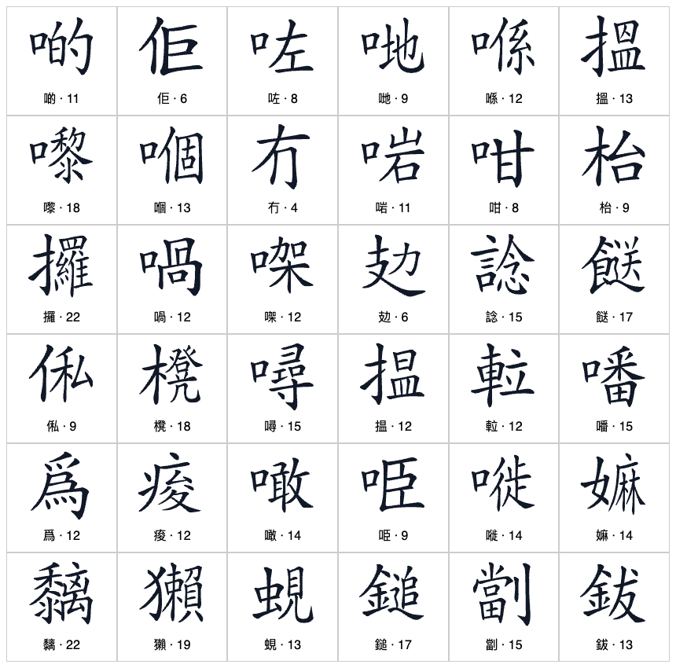

# Cantonese brush forms

Both writing pages use Hanzi Writer. The supplemental artwork ships as versioned static files on the frontend deployment. The standard characters load from the pinned upstream data package. The shared loader and the coverage command use the same catalogue in `config/writing-strokes.json`.

## Review before release

The sheet below shows the 36 brush forms rendered by the installed library. A Hong Kong handwriting reviewer should compare the shapes with the labels and play each character to check stroke order and direction. Start with 咗、佢、哋、啲、喺. Check the distinction between 搵 and 揾, the claw at the top of 爲, and the layout of 𨋢 and 𠱸. File presence and successful animation establish technical coverage. Hong Kong handwriting sign-off is pending.

## Check new content

Run `npm run check:strokes` from the frontend checkout with the sibling `openai-tts` repository available. To check a downloaded word snapshot, pass `-- --words /path/to/words`. For offline use, also pass `--inventory /path/to/inventory.json` with the flat jsDelivr file listing for the pinned upstream release. The command exits unsuccessfully for unsupported Han characters or malformed pack files.

For additions, include the ordered brush outlines and corresponding median paths, retain source and licence notices, add the character to the catalogue, then run the coverage check and preview the animation. For replacements of shipped artwork, give the pack a new version so the deployment and cache keys align. [Artwork provenance](../../public/strokes/cantonese-v1/NOTICE.txt)
